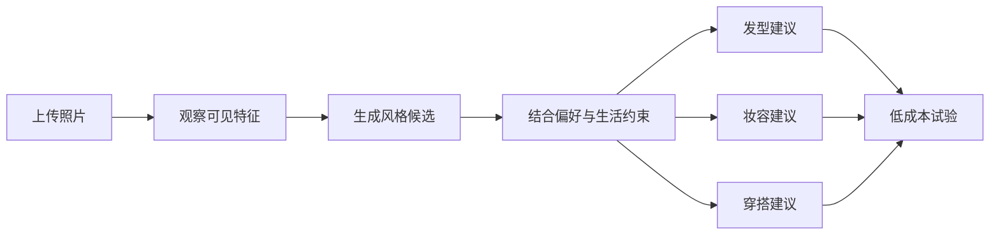

<div align="center">

# face-hairstyle-fit

### 找到适合自己的风格(穿搭、发型)

<p>
  根据用户照片与偏好，探索适合的风格方向，并生成发型、妆容与穿搭建议。
</p>

<p>
  <a href="https://github.com/konglong87/face-hairstyle-fit/actions/workflows/check.yml">
    
  </a>
  
  
  
  
  
</p>

<p>
  <strong>Find a style that fits your face, hair, and life.</strong>
</p>

</div>

> 上传一张照片，先找到适合你的风格方向，再把它落到发型、妆容和穿搭上。

很多人不是“不好看”，而是当前发型、妆容和穿搭没有形成统一的视觉表达。
`face-hairstyle-fit` 不做颜值打分，也不把用户固定成单一标签，而是提供一套可解释、
可尝试、可调整的个人风格方案。

## Contents

- [What it does](#what-it-does)
- [How it works](#how-it-works)
- [Style system](#style-system)
- [Example output](#example-output)
- [Who is it for](#who-is-it-for)
- [Privacy and boundaries](#privacy-and-boundaries)
- [Quick start](#quick-start)
- [Project structure](#project-structure)
- [Roadmap](#roadmap)
- [Community and support](#community-and-support)

## What it does

| 模块 | 解决的问题 | 输出内容 |
|---|---|---|
| 风格探索 | 不知道自己适合什么方向 | 主风格、备选风格、表达方向和理由 |
| 发型匹配 | 发型与脸部视觉框架不协调 | 发长、分缝、刘海、层次、纹理和打理建议 |
| 妆容协调 | 妆容重点与整体气质不统一 | 妆容边界、色彩、重点和完成度建议 |
| 穿搭协调 | 衣服、领口和近脸视觉不匹配 | 领口、近脸颜色、材质、结构和配饰方向 |
| 改造试验 | 不想一次性大幅改变 | 低成本、可逆的第一步尝试 |

## How it works



| 步骤 | 用户提供 | Skill 输出 |
|---|---|---|
| 1 | 单人照片 | 照片质量和可见信息边界 |
| 2 | 喜欢/避开的方向 | 风格候选与选择理由 |
| 3 | 发长、发质、打理时间等约束 | 发型、妆容、穿搭配方 |
| 4 | 用户试验后的反馈 | 调整方向和下一步方案 |

## Style system

案例中的风格词并不处在同一层，因此内部拆成三类：

| 层级 | 作用 | 当前内容 |
|---|---|---|
| **基础风格 family** | 描述主要造型气质 | 甜美系、柔和系、端庄大气系、清冷系、轻熟系 |
| **表达方向 expression** | 描述造型语言 | 韩系、日系、新中式 |
| **组合配方 recipe** | 组合多个视觉方向 | 甜酷、柔和法式、典雅新中式 |

> 韩系、日系和新中式在本项目中是造型表达方向，不是对用户国籍、族裔或身份的判断。

### 七维造型模型

| 维度 | 低值倾向 | 高值倾向 |
|---|---|---|
| 线条 | 圆弧、柔和转折 | 直线、明确转折 |
| 结构 | 松弛、流动 | 收束、受控 |
| 明暗对比 | 近脸元素差异小 | 多个明显对比焦点 |
| 色彩深浅 | 浅色、轻盈 | 深色、沉稳 |
| 鲜艳度 | 灰调、低饱和 | 鲜艳、强色彩焦点 |
| 装饰量 | 简洁、少装饰 | 纹样、配饰和细节较多 |
| 修饰精度 | 自然纹理、低整理感 | 发丝、妆容和搭配高度整理 |

这些维度是对“造型方案”的描述，不是颜值分数、概率，也不是训练得到的固定脸型分类器。
完整定义见 [`references/catalog.json`](references/catalog.json) 和
[`references/dimensions.md`](references/dimensions.md)。

## Example output

示例输出使用人工构造数据，不包含真人照片：

```text
主方向：柔和系
表达方向：韩系
推荐组合：柔和韩系

发型：
轻薄脸周层次，自然偏分，保留可调整的长度。

妆容：
保留轻薄底妆，只设置一个眉眼或唇色重点。

穿搭：
选择柔和近脸色和不太硬挺的材质，减少过多装饰。

第一步：
先只调整分缝和脸周弧度，不急着剪短或染发。
```

实际咨询中，Skill 会同时说明依据、不确定性、取舍、维护成本和下一步问题。

## Who is it for

| 用户情况 | 是否适合 |
|---|---|
| 不知道自己适合什么风格 | ✅ 适合 |
| 发型和穿搭总感觉不协调 | ✅ 适合 |
| 想换发型但不知道怎么和理发师沟通 | ✅ 适合 |
| 想尝试韩系、日系、新中式、清冷或轻熟方向 | ✅ 适合 |
| 想要颜值打分 | ❌ 不支持 |
| 想做人脸识别 | ❌ 不支持 |
| 想进行皮肤、脱发或其他医疗诊断 | ❌ 不支持 |

## Privacy and boundaries

> [!WARNING]
> 请不要把真实人脸照片、面部 embedding、API Key、Token、私钥或个人报告提交到 Git。

> [!IMPORTANT]
> 风格建议是可尝试的造型配方，不是对用户年龄、性别、族裔、性格、健康或社会身份的判断。

- 不做人脸识别，不跨图片匹配人物身份。
- 不做颜值评分，不制造“缺陷”叙事，也不承诺某种风格一定更好看。
- 不推断年龄、性别、族裔、健康、性格或社会身份。
- 不做皮肤、脱发、牙齿或其他医疗诊断。
- 仅有脸部照片时，穿搭建议限于领口、近脸颜色、材质和整体方向，不推测体型。
- 预期效果图只用于描述目标造型，不作为用户原生脸部的证据。
- 生成本地图片 QA 产物后，验收完成应删除带真人内容的临时文件。

真人案例提炼边界见 [`references/case-protocol.md`](references/case-protocol.md)。

## Quick start

Python 3.9+：

```sh
uv venv .venv
uv pip install --python .venv/bin/python -r requirements.txt
```

运行测试：

```sh
.venv/bin/python -m unittest discover -s tests -v
```

检查风格目录和示例报告：

```sh
.venv/bin/python scripts/skill_tools.py check-catalog
.venv/bin/python scripts/skill_tools.py check-report examples/provisional-report.json
```

生成本地静态报告：

```sh
.venv/bin/python scripts/skill_tools.py render \
  examples/provisional-report.json \
  --output artifacts/example.html
```

CLI 只负责 catalog/report 契约校验和静态 HTML 展示：

- 不执行图像分析；
- 不联网；
- 不读取照片；
- 会转义报告文字；
- 会拒绝覆盖已有输出；
- 会设置不加载远程资源的 CSP。

## Project structure

| 路径 | 作用 |
|---|---|
| [`SKILL.md`](SKILL.md) | Skill 入口和核心工作流 |
| [`references/catalog.json`](references/catalog.json) | 风格定义和推荐配方 |
| [`references/dimensions.md`](references/dimensions.md) | 七维造型模型 |
| [`references/case-protocol.md`](references/case-protocol.md) | 真人案例与隐私边界 |
| [`schemas/`](schemas/) | 输入输出契约 |
| [`scripts/`](scripts/) | 校验和静态报告工具 |
| [`tests/`](tests/) | 自动化测试 |
| [`docs/`](docs/) | 架构、方案 review 和 QA 记录 |

## Roadmap

### v0.1 · 已完成

- [x] 5 个基础风格
- [x] 韩系/日系/新中式表达方向
- [x] 3 个组合配方
- [x] 发型、妆容、穿搭三模块
- [x] JSON Schema 和契约校验
- [x] 隐私边界和案例协议
- [x] 三张真实案例本地回放

### v0.2 · 计划中

- [ ] 更多案例角色标注
- [ ] 更细的发质、发量和长度约束
- [ ] 理发师沟通稿
- [ ] 更多风格配方
- [ ] 可选的发型预览提示词

### 暂不计划

- [ ] 颜值评分
- [ ] 人脸识别
- [ ] 医疗诊断
- [ ] 自动上传用户照片

## Community and support

| 入口 | 用途 |
|---|---|
| [Discussions](https://github.com/konglong87/face-hairstyle-fit/discussions) | 使用疑问与风格模型讨论（仅脱敏文字） |
| [Issues](https://github.com/konglong87/face-hairstyle-fit/issues/new/choose) | Bug 与功能/风格提案 |
| [CONTRIBUTING.md](CONTRIBUTING.md) | 贡献流程与验证清单 |
| [SUPPORT.md](SUPPORT.md) | 使用支持与反馈方式 |
| [SECURITY.md](SECURITY.md) | 安全与隐私报告流程 |
| [CHANGELOG.md](CHANGELOG.md) | 版本能力与限制 |

> [!CAUTION]
> 请不要在 Issue、Discussion 或 PR 中上传真人照片、个人分析报告或有效凭据。

## License

MIT License，见 [`LICENSE`](LICENSE)。
